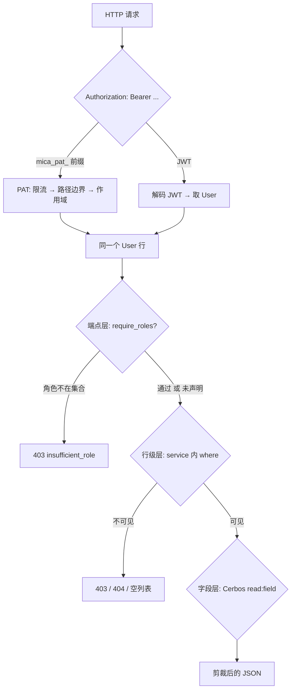
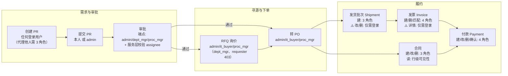
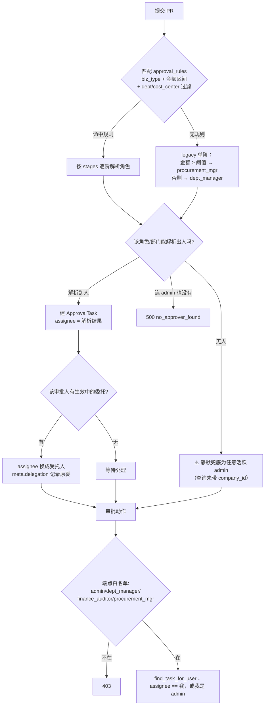
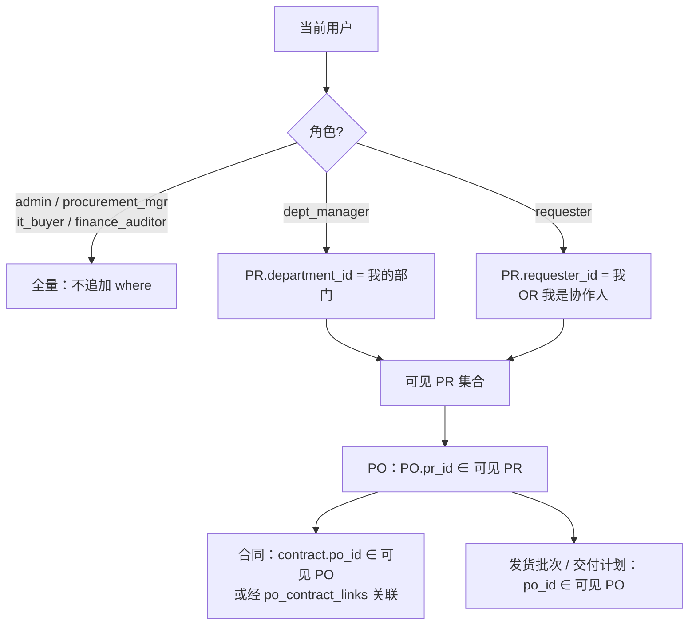
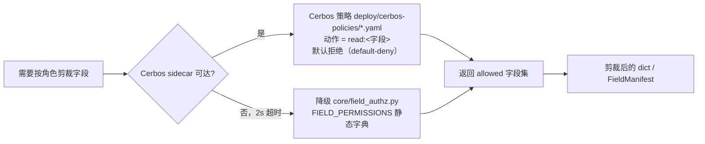
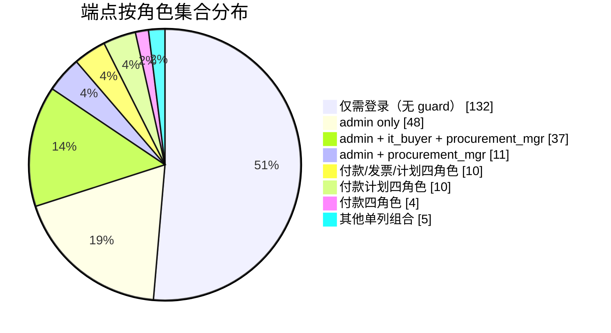

# Mica 权限设计梳理（as-implemented）

> **这份文档是什么**：从**当前代码实现**中提取的权限事实清单，用于团队评审与修改。它描述"系统现在怎么做"，不是"设计意图应该怎么做"。
>
> **基准**：`main @ d7528a1`（v1.57.0）。每个结论都给出可复核的 `file:line`。
> **怎么读**：[§1](#1-权限模型总览)–[§2](#2-六种角色) 是模型总览；[§3](#3-采购主线各节点的角色要求) 是采购主线；[§4](#4-行级可见性)–[§5](#5-字段级可见性) 是行级/字段级；[§6](#6-流程之外的操作) 是流程外操作；[§7](#7-前端-ui-门控与后端的对齐现状) 是前端门控；**要讨论的话直接跳 [§8 风险清单](#8-不一致与风险清单) 与 [§9 议题](#9-建议的评审议题)**。
> **与既有文档的关系**：仓库里已有两份权限说明——`docs/user-manual/01-roles-and-permissions.md`（面向业务用户，自标 v1.21.0）与 `docs/user-manual/admin/05-permissions.md`（面向管理员，34 行）。两份都与实现有出入，逐条差异见 [R8](#r8)。**本文件是评审用的实现快照，不建议长期作为第三份常驻文档**——定稿后应由它派生出上述两份。
> **复核方式**：见 [§10 附录](#10-附录如何重新生成这份清单)。

> **⚠️ 时效性（2026-10-21）**：本文基准为 **v1.57.0**，此后以下版本改动了权限或可见性相关行为，阅读前请对照 [CHANGELOG](../CHANGELOG.md)：
>
> | 版本 | 改动 |
> | :--- | :--- |
> | v1.59.0 | 收货解耦：新增收据端点与 PO 四态，收货权限由「可见订单者」决定 |
> | v1.61.0 | 合同实体：合同主体（company）与订单一致性校验 |
> | v1.63.0 / v1.67.0 | 先票/后票：付款执行权限扩展到订单付款计划 |
> | v1.63.1 | 飞书回调强制验签（该端点可改写付款状态） |
> | v1.64.0 / v1.64.1 | 预测按币种统计（数据口径变化） |
> | v1.65.0 | 新增询价单生成端点（与查看 RFQ 同一可见性规则） |
> | v1.65.2 | 新增待取回询价单端点（隐藏角色返回空） |
> | v1.68.0 | 新增扫描报价预览端点（只读，不写业务数据） |
>
> 上述新增端点均沿用本文 §1 的端点层规则（`require_roles` + 服务内可见性），未引入新的授权模型；但**具体角色集合请以代码为准**，本文表格中的行号已随重构漂移。

---

## 1. 权限模型总览

Mica 的权限由**四层**叠加决定，任何一次请求都要穿过全部四层：

| 层 | 作用域 | 实现位置 | 粒度 |
| :--- | :--- | :--- | :--- |
| ① 凭据层 | 这个请求代表谁 | `core/security.py` + `services/api_tokens.py` | PAT / JWT |
| ② 端点层 | 这个角色能否调这个接口 | `require_roles(...)` / router 级 guard / 少量函数内 helper | 角色集合 |
| ③ 行级层 | 这条记录该不该被这个用户看到 | `core/scoping.py` + 各 service 的 where 条件 | 记录 |
| ④ 字段层 | 这条记录里哪些字段可见 | `core/cerbos_client.py` → Cerbos；降级 `core/field_authz.py` | 字段 |



> ⚠️ **注意四层并不总是全部生效**：端点层"未声明 guard"的接口（本仓库共 **132 个**，占多数）只靠行级层兜底；而行级层只覆盖 PR / PO / 合同 / 交付计划 / 交付地址 / 导出这些实体（详见 [§4](#4-行级可见性)）。

---

## 2. 六种角色

角色枚举定义在 `backend/app/models/__init__.py:38-44`。**一个用户只有一个角色**（`User.role` 单值，`models/__init__.py:256`），且 `User.company_id` 也是单值（`:257`）——不存在"同一人在不同公司持不同角色"的数据结构。

| 角色码 | 中文名 | 在权限体系中的实际位置 |
| :--- | :--- | :--- |
| `admin` | 管理员 | 全通。端点层大量 admin-only；`authz.check_permission` 里硬编码直接返回 True（`core/authz.py:43-44`）；行级层无过滤 |
| `procurement_mgr` | 采购经理 | 行级全通；审批第二阶（大额）；与 admin 共享多数主数据/分类管理写权限 |
| `it_buyer` | IT 采购员 | 行级全通（`core/scoping.py:21-28`）；采购主线执行主力；**不能审批** |
| `finance_auditor` | 财务审核 | 行级全通；付款/发票/付款计划写入方；可被配为审批阶 |
| `dept_manager` | 部门负责人 | 行级**限本部门**；审批第一阶（默认规则）；RFQ 对其完全隐藏；不能写付款/发票 |
| `requester` | 需求方 | 行级**限本人 + 协作人**；RFQ 完全隐藏；**在字段级策略中完全没有条目**（见 [§8-R1](#r1)） |

### 2.1 三个"非角色"主体

权限体系里还有三类主体不通过角色判定，评审时不要遗漏：

| 主体 | 凭据 | 权限语义 |
| :--- | :--- | :--- |
| 个人访问令牌（PAT） | `mica_pat_...` | 继承所属用户的角色，但被三层额外约束：作用域（`read` / `write`）、路径硬边界（`/admin`、`/saml`、`/auth`（除 `/auth/me`）、`/me/tokens` 的写操作一律 403）、按令牌限流。见 `services/api_tokens.py:44-66, 241-300` |
| 供应商门户 | URL 里的 `Supplier.access_token` | 无需登录，持令牌即读该供应商的 PO / 合同 / 付款 / 发货（`api/v1/supplier_portal.py:97-...`） |
| 文档下载令牌 | 一次性 token，TTL 由 `auth.download_token_ttl_seconds` 控制 | **签发时不校验调用者与该文档的关系**，见 [§8-R3](#r3) |

**完全公开的端点**（无认证，9 个）：`POST /auth/login`、`POST /auth/login/json`、`GET /auth/login-options`、`/saml/*`（metadata/login/acs）、`POST /feishu/webhook`、`GET /documents/download/{token}`、`GET /supplier-portal/{token}`。

---

## 3. 采购主线：各节点的角色要求



### 3.1 动作 × 角色矩阵（采购主线）

图例：`✓` 允许 · `✗` 拒绝（403） · `条件` 见备注 · `⚠️` 实现上缺门限

| 动作 | admin | procurement_mgr | it_buyer | finance_auditor | dept_manager | requester | 备注 / 证据 |
| :--- | :-: | :-: | :-: | :-: | :-: | :-: | :--- |
| 创建 PR | ✓ | ✓ | ✓ | ✓ | ✓ | ✓ | 端点无 guard；**代理他人创建**限 admin/it_buyer/proc_mgr（`services/purchase.py:140-151`） |
| 编辑 PR | ✓ | ✓ | ✓ | ✗ | ✗ | 仅本人 | 他人不可改；状态门限：draft/returned 可改，approved 仅 admin/it_buyer/proc_mgr，其余 409（`services/purchase.py:279-294`） |
| 提交 PR | ✓ | ✗ | ✗ | ✗ | ✗ | 仅本人 | admin 可代提交；需 status ∈ draft/returned 且有行项（`services/purchase.py:434-439`） |
| 审批 PR | ✓ | ✓ | ✗ | ✓ | ✓ | ✗ | 端点为 `admin,dept_manager,finance_auditor,procurement_mgr`（`api/v1/purchase.py:165`）；**服务层还要校验是否为该任务的 assignee** |
| 取消已批准 PR | ✓ | ✓ | ✓ | ✗ | ✗ | 仅本人 | 状态必须 approved 且尚未生成任何 PO（`services/purchase.py:529-540`） |
| 删除 PR | ✓ | ✓ | ✓ | ✓ | 仅本部门 | 仅本人/协作 | 端点无 guard，靠 `get_pr` 行级（`services/purchase.py:2052-2061`）；仅 draft/returned/rejected/cancelled 可删 |
| PR 转 PO（整单/拆分） | ✓ | ✓ | ✓ | ✗ | ✗ | ✗ | `api/v1/purchase.py:205,222` |
| 维护 PR 供应商报价 | ✓ | ✓ | ✓ | ✗ | ✗ | ✗ | `/save-quotes` |
| 创建 RFQ / 发送 / 改 / 报价 / 定标 / 删 | ✓ | ✓ | ✓ | ✗ | ✗ | ✗ | `api/v1/rfq.py`；读 RFQ 对 dept_manager/requester 返回 403（`services/rfq.py:17-19`） |
| 创建合同 | ✓ | ✓ | ✓ | ✗ | ✗ | ✗ | |
| 改合同 / 改状态 / 删合同 | ✓ | ✓ | ✓ | ✗ | ✗ | ✗ | |
| 删除合同附件 | ✓ | ✓ | ✓ | ✗ | ✗ | ✗ | |
| **上传合同附件** | ✓ | ✓ | ✓ | ✓ | ✓ | ✓ | ⚠️ 端点无 guard，服务层只查合同/文档存在（`api/v1/contracts.py:25`、`services/contracts.py:36-48`） |
| 创建发货批次 | ✓ | ✓ | ✓ | ✗ | ✗ | ✗ | `POST /shipments`（已有集成测试断言 requester 403） |
| **修改 / 删除发货批次** | ✓ | ✓ | ✓ | ✓ | ✓ | ✓ | ⚠️ 端点无 guard，服务层无归属/可见性校验（`services/flow.py:884-982`） |
| **记录序列号** | ✓ | ✓ | ✓ | ✓ | ✓ | ✓ | ⚠️ 同上（`services/flow.py:1096`） |
| **PO 附件增删 / 发货单附件增删** | ✓ | ✓ | ✓ | ✓ | ✓ | ✓ | ⚠️ 无角色、无可见性校验；删除路径甚至不接收 actor（`services/flow.py:1032-1092`） |
| 创建发票 | ✓ | ✓ | ✓ | ✓ | ✗ | ✗ | ⚠️ 注意：**it_buyer 可创建发票**，与 user-manual 陈述不符 |
| 删除发票 / 行匹配 | ✓ | ✓ | ✓ | ✓ | ✗ | ✗ | |
| **查看发票详情 / 可用 PO 行** | ✓ | ✓ | ✓ | ✓ | 条件 | 条件 | ⚠️ 端点无 guard、服务层无校验（`api/v1/flow.py:558-578`、`:673`）；列表端点则限 4 角色 |
| 创建付款 | ✓ | ✓ | ✓ | ✓ | ✗ | ✗ | `_PAYMENT_WRITE_ROLES`（`services/flow.py:45-51`）；⚠️ it_buyer 在内 |
| 改 / 删 / 确认付款 | ✓ | ✓ | ✓ | ✓ | ✗ | ✗ | 同上 |
| 查看付款列表 / 导出 | ✓ | ✓ | ✓ | ✓ | ✗ | ✗ | dept_manager 不在列表端点 |
| 付款计划（增删改、执行） | ✓ | ✓ | ✓ | ✓ | ✗ | ✗ | `_SCHEDULE_WRITE_ROLES`（`api/v1/payment_schedule.py:25`） |
| 履约链接（PR↔PO）增删改 | ✓ | ✓ | ✓ | ✗ | ✗ | ✗ | |
| PO 行项 / 配套补充项 增删改 | ✓ | ✓ | ✓ | ✗ | ✗ | ✗ | |
| 删除 PO | ✓ | ✗ | ✗ | ✗ | ✗ | ✗ | 单据类动作里唯一的 admin-only（主数据与后台另有更多，见 [§6](#6-流程之外的操作)） |
| PO 台账 / PDF 导出 | ✓ | ✓ | ✓ | ✓ | ✗ | ✗ | |
| 交付计划 增删改 / 总览 | ✓ | ✓ | ✓ | ✗ | ✗ | ✗ | 读列表有行级过滤 |
| 交付地址 | ✓ | ✓ | 自己的 + 公司共享（只读） | 同左 | 同左 | 同左 | 共享条目仅 admin/proc_mgr 可维护（`services/delivery_addresses.py:30-45`） |

### 3.2 审批链路是谁在决定"谁能批"

审批不是靠角色写死的，而是**规则表 + 任务指派**两层：规则决定"这一阶该由哪类人批"，任务决定"这一次具体派给了谁"。



**规则与指派的关键细节**

| 环节 | 实现事实 | 证据 |
| :--- | :--- | :--- |
| 规则匹配 | 先按 `biz_type` + 金额（`amount_max` 是**开区间**）取候选，按 `priority ASC, created_at ASC` 排序，取第一条通过部门/成本中心过滤的 | `services/approval.py:219-243` |
| 部门/成本中心过滤 | `department_ids` / `cost_center_ids` 为 NULL → 不过滤；**空数组也视为不过滤**（与 AGENTS §5.5 要求的"空数组须规范化为 NULL"相反）；PR 没有部门且过滤器非空 → 不匹配，落到 legacy 分支 | `services/approval.py:246-259` |
| 默认规则 | ≤ ¥100,000 单阶 `dept_manager`；> ¥100,000 两阶 `dept_manager` → `procurement_mgr` | `migrations/versions/0005_approval_rules_dsl.py:99-149` |
| 阈值 | `approval.amount_threshold_cny`（seed 100000），用于**无规则时的 legacy 回退** | `services/approval.py:362-377` |
| 部门树回溯 | 本部门无 `dept_manager` 时沿 `Department.parent_id` 上溯（带环保护）；开关 `approval.dept_manager_chain_lookup`（默认 true） | `services/approval.py:81-106, 334-335` |
| ⚠️ 无部门时 | `dept_manager` 而 `department_id` 为 NULL → 降级为**全公司所有部门负责人**都可能被分派 | `services/approval.py:125-133` |
| 同阶多人 | 解析出多人时全部建 task，**一人批准其余自动 skipped** | `services/approval.py:404-436, 714-722` |
| 指定审批人 | 必须 ⊆ 规则解析出的候选集（且候选是**委托替换之后**的集合）；开关 `approval.allow_submitter_preferred_approver` | `services/approval.py:454-512` |
| 委托 | 委托在**建单时**替换 assignee，不是处理时动态判定 → 建单后才建的委托对已有任务无效；`assignee_role` 仍写原角色 | `services/approval.py:147-168, 186-209, 425-433` |
| 无人可批 | **静默兜底为"任意活跃 admin"**，且该查询**没有 `company_id` 过滤**；只有连 admin 都没有才 500 | `services/approval.py:135-144` |
| 候选人角色校验 | ⚠️ 委托的**受托人角色不受约束**（只查 `is_active`）→ 可把任务委派给处理不了的账号 | `services/approval.py:191-194` |
| 自我审批 | ⚠️ 解析 `dept_manager` 时**不排除提交人自己** → 申请人本人是 dept_manager 时，自己的 PR 会分派给自己（可自批） | `services/approval.py:91-99, 404-436` |
| 审计 | `decide_pr` 会写 `pr.{action}` 审计；而通用端点 `/approval/tasks/{id}/action` **不写任何审计日志**，且 `ApprovalTask` 没有 actor 列 → admin 代批不可追溯 | `services/purchase.py:508-515`；`api/v1/approval.py:70-73`；`models/__init__.py:1256-1281` |

**两个审批入口并不等价**（评审时容易忽略）

| | `POST /purchase-requisitions/{id}/decide` | `POST /approval/tasks/{id}/action` |
| :--- | :--- | :--- |
| 端点白名单 | `admin, dept_manager, procurement_mgr` | `admin, dept_manager, finance_auditor, procurement_mgr` |
| 是否回写 PR 状态 | ✅ 会（approved/rejected/returned） | ❌ **不会** → 实例已 approved 而 PR 仍 `submitted` |
| 是否写审计 | ✅ | ❌ |
| 使用者 | 前端只调这个 | 纯 API 面 |

### 3.3 三个需要评审拍板的审批问题

1. **`it_buyer` 阶段是死任务**：规则 DSL 允许把某阶配成 `it_buyer`，但两个 action 端点的白名单都**没有 it_buyer**（`api/v1/approval.py:62-65`、`api/v1/purchase.py:165`）→ 任务派得出去、永远批不动，只能 admin 兜底。
2. **"无人可批"的四条静默路径**：兜底为全库任意 admin（无公司过滤）、`dept_manager` 无部门时扩散到全公司、委托受托人角色不校验、提交人可与审批人重合。这四条都会让"审批"在无人察觉的情况下失去约束。
3. **admin 的通用逃生舱**：`find_task_for_user` 在 admin 时直接取 `tasks[0]`（依赖数据库返回顺序，无 `ORDER BY`）→ admin 可代任意人批准任意实例，且无审计、无 actor 记录。

**提醒与升级**（只催办，不升级给管理者）：

- 催办：开关 `approval.reminder_enabled`，阈值 `approval.reminder_hours`（默认 4h），收件人**仅当前 pending 任务的处理人**（`services/approval_reminder.py:30-66`）。
- SLA 告警：阈值 `approval.sla_hours`（默认 24h），收件人为提交人 + 该公司 `procurement_mgr` + `admin`（`services/sla_escalation.py:40-186`，这一路的 `bulk_notify_role` **带公司过滤**）。
- ⚠️ `approval.sla_urgent_hours`（seed 4h）在代码中**未被使用**。

---

## 4. 行级可见性

行级过滤只在**部分实体**上实现，收敛在 `core/scoping.py`：



| 实体 | 行级过滤 | 实现 |
| :--- | :--- | :--- |
| PR | ✅ | `core/scoping.py:48-67`；`services/purchase.py:1871-1900`（读单条）/ `:1892-1905` |
| PO | ✅（经 PR 派生） | `services/purchase.py:2012-2024, 2034-2048` |
| 合同 | ✅（经 PO 派生） | `services/contracts.py:256-258`、`services/flow.py:404-417` |
| 发货批次 Shipment | ✅（列表，经 PO/合同派生） | `services/flow.py:832-880` |
| 交付计划 | ✅ | `services/delivery_plans.py:191-201` |
| 交付地址 | ✅（公司共享 + 本人） | `services/delivery_addresses.py:43-45` |
| 导出数据 | ✅（逐数据集） | `services/export_datasets.py`（多处） |
| RFQ | ⚠️ 不是过滤，是**整体禁止** | dept_manager / requester 直接 403（`services/rfq.py:17-19`） |
| 发票 / 付款 / 附件 / 序列号 | ❌ 无 | 详见 [§8-R4](#r4) |
| **公司维度** | ❌ **完全没有** | `company_id` 只出现在审批人解析、通知分发、交付地址、导出过滤器中，从不作为行级隔离条件 |

> **公司隔离的现状**：虽然 `User.company_id` 存在、前端有公司筛选器，但后端行级过滤里没有任何 `company_id` 条件。也就是说 `<多公司数据隔离>` 目前**只靠 UI 筛选器**，不构成权限边界。

---

## 5. 字段级可见性

字段级由**两条可能互斥的路径**决定：



- **主路径**：`core/cerbos_client.py:23-82`，动作名 `read:<field>`，超时 2 秒。
- **降级路径**：`core/field_authz.py:337-341`。语义是"**该角色在该 kind 下没有条目 → 返回全部字段**"。
- **被字段级管辖的 kind**（10 个）：`purchase_requisition`、`purchase_order`、`payment_record`、`invoice`、`contract`、`supplier`、`item`、`sku_price_record`、`shipment`、`delivery_plan`。

### 5.0 ⚠️ 字段级权限实际只作用在三个地方

这一点与直觉不符，务必在评审时确认：**字段级剪裁并没有施加在 PR / PO / 发票 / 付款的常规 API 响应上**。全仓库调用字段级过滤的位置只有三处：

| 调用点 | 作用对象 | 证据 |
| :--- | :--- | :--- |
| `GET /authz/field-manifest/{resource}` | 只返回"该角色能看到哪些字段名"的清单，**不含数据** | `api/v1/authz.py:83-94` |
| 全局搜索结果的 `meta` | 搜索命中项的元数据 | `services/search.py:101-111` |
| Excel / 台账导出 | 导出列 | `services/export_excel.py:458` |

```bash
# 复核：全部调用点
grep -rn "filter_dict_via_cerbos(\|check_field_access(" backend/app --include=*.py | grep -v "^backend/app/core/"
```

因此：

- `GET /api/v1/purchase-orders/{id}`、`/purchase-requisitions/{id}`、`/invoices/{id}` 等返回的是**完整字段**（受 `response_model` 约束，不受角色约束）——`api/v1/purchase.py:97,110,358` 均为直接 `PROut/POOut.model_validate(...)`。
- `user-manual/01` §3 所述"角色看不到的字段不会出现在响应里"，在当前实现中**只对导出与搜索 meta 成立**。
- 前端确实存在 `api.fieldManifest()` 封装（`frontend/src/api/index.ts:1881-1882`），但**没有被任何页面引用**：`grep -rn "fieldManifest" frontend/src` 只有定义处。所以字段级权限目前既不是后端强制、也不是前端生效。

> **结论**：把字段级权限当作"已实现的保护"是当前最大的认知风险。它目前更像一条**半成品能力**（策略、客户端、清单端点都在，但数据面没接）。

### 5.1 字段白名单（`core/field_authz.py` 实测值）

下表的数字由 AST 解析 `FIELD_PERMISSIONS` 得出（`ALL` = 无条目或通配 `*` → 全字段可见）。

| kind | admin | proc_mgr | it_buyer | finance_auditor | dept_manager | requester |
| :--- | :-: | :-: | :-: | :-: | :-: | :-: |
| purchase_requisition | ALL | ALL | ALL | 18 | ALL | **ALL** |
| purchase_order | ALL | ALL | 15 | ALL | 12 | **ALL** |
| payment_record | ALL | ALL | 11 | ALL | 8 | **ALL** |
| invoice | ALL | ALL | 10 | ALL | 8 | **ALL** |
| contract | ALL | ALL | 15 | ALL | 14 | **ALL** |
| supplier | ALL | ALL | 11（**无银行账号/税号**） | ALL | 9 | **ALL** |
| item | ALL | ALL | ALL | ALL | 11 | **ALL** |
| sku_price_record | ALL | ALL | 24 | ALL | 13 | **ALL** |
| shipment | ALL | ALL | 20 | ALL | 17 | **ALL** |
| delivery_plan | ALL | ALL | ALL | ALL | 12 | **ALL** |

**两份策略的一致性已核对通过**：`deploy/cerbos-policies/*.yaml`（Cerbos 主路径）与 `backend/app/core/field_authz.py`（降级路径）在全部 10 个 kind × 6 个角色上**字段集合完全一致**。也就是说：**降级不是"变宽松"，只是换了一份同等强度的规则源**。

**唯一例外是 `requester`**：两份策略里都没有 `requester` 的条目。
- 走 Cerbos（主路径）→ 默认拒绝 → **该 kind 所有字段被拒**（`filter_dict_via_cerbos` 会返回空 dict）；
- 走降级路径 → 无条目即放行 → **全部字段可见**（`field_authz.py:337-341`）。

即：Cerbos 在线时 requester 更严（近乎看不到字段），Cerbos 挂掉时反而全开。这是 [R1](#r1) 的核心问题。

---

## 6. 流程之外的操作

| 功能域 | 动作 | 允许角色 | 备注 |
| :--- | :--- | :--- | :--- |
| **主数据** · 供应商 | 增 / 改 / 批量改 / 删 | admin, procurement_mgr, it_buyer | 读：登录即可（字段级遮蔽银行/税号） |
| 主数据 · 物料 | 新建 | admin, procurement_mgr, it_buyer, **requester** | requester 可现场建物料（配合 SKU 选择器） |
| 主数据 · 物料 | 改 / 删 | admin, procurement_mgr, it_buyer | |
| 主数据 · 公司 / 部门 | 增删改 | **admin only** | |
| 主数据 · 成本中心 / 采购分类 / 字典值 | 增删改 | admin, procurement_mgr | |
| 主数据 · SKU 价格 | 登记 | admin, procurement_mgr, it_buyer | 价格异常确认同此三角色 |
| 主数据 · 导入 | 供应商导入 / 价格导入 | **admin only** | 物料导入为三角色 |
| **管理后台** | 用户增删改、重置密码 | **admin** | `admin.py` router 级 guard，26 个端点 |
| 管理后台 | 系统参数、AI 模型与路由、飞书设置、调度器、性能统计 | **admin** | |
| 管理后台 | 审计日志、AI 调用日志 | **admin** | |
| 管理后台 | 审批规则 CRUD | **admin** | `approval_rules.py` router 级 guard |
| 管理后台 | 回收站查看 / 恢复 | **admin** | |
| 管理后台 | 全局 PAT 管理 | **admin** | |
| **洞察** | 预算 增 / 查 / 执行 / 删 | **admin, procurement_mgr** | `_require_insights_manager`（`api/v1/insights.py:345-355, 476-570`） |
| 洞察 | 仪表盘指标 / 账龄 / 发票匹配 / 付款日历 / 偏差率 | 登录即可 | `dashboard.py`：requester 与 dept_manager 的**部分**端点按部门收窄（`_restricted_roles()`，`:122-123`） |
| **导出** | 数据集目录 / 执行导出 | **admin, procurement_mgr, it_buyer, finance_auditor** | `EXPORT_ROLES`（`services/export_registry.py:63`）——**requester 与 dept_manager 完全不可用**；每个数据集另有自己的角色白名单 + 字段级 + 行级三重过滤 |
| **协作** | 通知已读 / 订阅设置 | 本人 | |
| 协作 | 审批委托（自己的） | 本人；admin 可代撤销 | `api/v1/approval_delegations.py:86` |
| 协作 | PAT（自己的） | 本人 | 令牌**不能**自我铸造/轮换/撤销（`services/api_tokens.py:241-253`） |
| 协作 | 全局搜索 | 登录即可 | ⚠️ 可见性与列表不一致，见 R2 |
| 协作 | AI 助手 / 发票识别 / 合同识别 | 登录即可 | |
| 协作 | 文档上传 | 登录即可 | ⚠️ 谁都能传，且上传者与业务实体无绑定 |
| 协作 | 资源活动日志 | 登录即可，但按资源可见性收敛 | 黑名单事件前缀 `auth.*`/`admin.*`/`notification.*` |
| 组织 | 公司 / 部门列表、UI 配置 | 登录即可 | |

### 6.1 端点层角色分布（全量 257 条路由）



统计口径：256 个 HTTP 端点 + 1 个 WebSocket（`/ws/notifications`，JWT 校验在 handler 内）。**只有约一半端点声明了角色 guard**，另一半依赖行级过滤或业务前置条件。

---

## 7. 前端 UI 门控（与后端的对齐现状）

前端**没有统一的权限抽象**：`useAuth` 只暴露 `user`，而 `user.role` 是裸 `string`（无联合类型约束，拼错不会被 `tsc` 拦下），也没有 `hasRole` / `permissions` 之类的入口（`frontend/src/auth/useAuth.ts:6-56`、`api/index.ts:5-15`）。结果是每个页面各写各的角色判断，全仓约 80 处 gate，偏差集中在下面三类。

### 7.1 路由与菜单

- **唯一的角色路由门**是 `ProcurementGate`，语义其实是"**非 requester**"（`routes/index.tsx:140-146`），覆盖 12 条路由（payments / invoices / sku / rfqs / suppliers / items 及其详情页）。
- `PROCUREMENT_ROLES`（`routes/index.tsx:148`）与 `hideForRequester`（`:150`）是**死代码，无任何引用**——也就是说门控并没有用那个"采购四角色"白名单。
- **没有任何角色门保护的路由**：`/purchase-orders`、`/purchase-orders/:id`、`/contracts`、`/contracts/:id`、`/approvals`、`/insights`、`/admin*`（后者只靠页面内 `Admin.tsx:32` 兜底）。注意 `/contracts` 在菜单里对 requester 隐藏了，但**路由不拦** → 手输 URL 可进。
- 侧边菜单：7 项对 requester 隐藏（`AppLayout.tsx:121-129`），`/admin` 仅 admin（`:131-133`）。

### 7.2 与后端角色集合不一致的 UI 门控

**A. 过窄——该看到的人看不到（功能缺失类）**

| 位置 | 前端允许 | 后端实际 | 后果 |
| :--- | :--- | :--- | :--- |
| PR 审批三按钮 `PRDetail.tsx:160`（→ `:654,731`） | dept_manager, admin | admin, dept_manager, **procurement_mgr** | `procurement_mgr` **看不到审批按钮**——与 AGENTS §5.15 记载的历史缺陷同类 |
| 物料新建 `Items.tsx:105` + `/items` 路由 gate | 非 requester | 后端 `master_data.py` 允许 **requester** 建物料 | requester 无法"现场建物料"，与后端设计意图相反 |

**B. 过宽——按钮在、点了 403（体验类）**

| 位置 | 前端允许 | 后端实际 |
| :--- | :--- | :--- |
| RFQ 发送 / 删除 / 录入报价 / 授标 `RFQDetail.tsx:55,56,57`（只判状态，不判角色） | 任何进得来的人 | admin, it_buyer, procurement_mgr → `finance_auditor` 经路由放行后可点，403 |
| 交付计划 新建/编辑/拆分/删除 `DeliveryPlans.tsx:20`（`!isRequester`） | 非 requester | admin, procurement_mgr, it_buyer → finance_auditor、dept_manager 看到写按钮 |
| 发货 新建 `Shipments.tsx:29,154`（`!isRequester`） | 非 requester | admin, procurement_mgr, it_buyer |
| 记录发票 / 删除发票 `InvoicesTab.tsx:44,65`（无门控） | 全部（PO 详情路由无 gate） | 四角色 → requester 直达可见 |
| 合同详情内的发货编辑/删除 `ContractDetail.tsx:558` | 全部 | 该文件其余写按钮都已 gate，**这是唯一漏掉的一处** |
| 扫描创建合同 `Contracts.tsx:248-268` | 全部 | admin, procurement_mgr, it_buyer |
| PO 导出 PDF / 打印 `POHeader.tsx:81-101` | 全部 | 四角色 |
| 新建供应商 `Suppliers.tsx:397-409`、物料编辑/删除 `Items.tsx:187-188` | 全部 | admin, procurement_mgr, it_buyer |
| 待办审批页 `/approvals`（无路由 gate，`Approvals.tsx:15-18`） | 全部 | admin, dept_manager, procurement_mgr, finance_auditor → requester 进入得到 403/空表且无提示分支 |

**C. 反向一例**：发货「编辑/删除」在后端**没有 guard**（见 [R4](#r4)），前端却对 requester 隐藏——这一处前端比后端**严**。

### 7.3 其他渲染假设

- `Dashboard.tsx:229` 的 `user?.role || 'admin'`：`user` 为 `null` 的瞬间按 admin 计算所有角色分支（含管理后台入口）。是渲染假设而非授权漏洞，但会造成误导性闪现。
- 角色判断散落在约 20 个文件里，只有导出角色抽成了共享常量（`components/Export/exportRoles.ts:6`）。

> 与 AGENTS.md §5.15 的关系：该约定要求"后端改 `require_roles` 必须同步前端 `can*`，反之亦然"。上表说明这条约定目前有 **10 处以上未落实**，且**两个方向都有**（既有前端过窄导致"找不到按钮"，也有前端过宽导致"点了 403"）。

---

## 8. 不一致与风险清单

以下每一条都是**已核实的**实现事实。R1–R5 是权限/可见性问题，R6–R7 是本次梳理中顺带发现的相邻风险（不属于角色权限，但同样会绕过内控），R8–R9 是文档与实现的差异及待确认项。

### <a id="r1"></a>R1 · 字段级权限：没接到数据面 + 两条语义相反的路径 + 两套规则源

| 现象 | 证据 |
| :--- | :--- |
| **字段级剪裁只作用于 3 个地方**（清单端点 / 搜索 meta / Excel 导出），PR、PO、发票、付款的常规响应**不做剪裁** | 全仓库调用点只有 `api/v1/authz.py:90`、`services/search.py:104`、`services/export_excel.py:458`；详见 [§5.0](#5-字段级可见性) |
| 前端有 `fieldManifest()` 封装，但**没有任何页面调用它** | 定义在 `frontend/src/api/index.ts:1881-1882`；`grep -rn "fieldManifest" frontend/src` 无第二处命中 |
| `requester` 在两份字段策略里都**没有条目** → Cerbos 下全字段被拒、降级下全字段放行 | Cerbos 默认拒绝（`core/cerbos_client.py:64-73`）；降级 `core/field_authz.py:337-341`（`perms is None` → 原样返回） |
| 存在**第二套规则源**：`backend/cerbos-policies/`（仅 2 个文件，且是粗粒度动作 `read`/`list`/`create`/`decide`/`convert`），只服务于 `authz.check_permission` | `core/authz.py:9`（`parents[2]`）；与 `deploy/cerbos-policies/` 同名文件内容不同 |
| 而 Cerbos sidecar 挂载的是 `deploy/cerbos-policies/`（10 个文件，字段级 `read:<field>`） | `deploy/docker-compose.yml:120` |

> ✅ **已核对通过的一点**：`deploy/cerbos-policies/*.yaml` 与 `core/field_authz.py` 在 10 个 kind × 6 个角色上的字段集合**完全一致**。所以"降级"不是变宽松，只是换了一份同等强度的规则源（`requester` 除外，见上）。这排除了"镜像漂移"的怀疑，真正的问题是**覆盖面和判定路径**。

**影响**：三层里最弱的一环被当成了已实现的保护——文档（`user-manual/01` §3）描述"响应里看不到字段"，但数据面没有接；同时 `check_permission` 与 Cerbos 是两套独立判定，规则来源不同。

**建议决策**：①明确字段级权限**是否要做**——若不做，就把它从文档承诺里移除；若要做，把 `filter_dict_via_cerbos` 接进 PR/PO/发票/付款的序列化路径；②为 `requester` 显式补策略条目（不要依赖"没条目"）；③降级路径改 fail-closed；④收敛 `backend/cerbos-policies/` 的用途或删除。

### <a id="r2"></a>R2 · 搜索的可见性规则与列表不一致

| 现象 | 证据 |
| :--- | :--- |
| `requester` 搜不到任何 PR——包括自己提的 | `services/search.py:85-98` 的 `_can_view_pr` 对 requester 返回 `False`；而列表走 `visible_pr_filter`，本人可见（`core/scoping.py:61-67`） |
| `it_buyer` 在搜索里只能搜到**自己提的** PR，在列表里却是全量 | 同上 `it_buyer → pr.requester_id == actor.id`，与 `_FULL_ACCESS_ROLES`（含 it_buyer）矛盾 |
| `requester` / `dept_manager` 能搜到**全部合同**，含金额与到期日 | `_search_contracts(db, query)` 没有 actor 参数、没有可见性条件、没有 `check_permission`（`services/search.py:193-222`） |
| PO 搜索同样无行级过滤（只要 `check_permission` 通过） | `services/search.py:157-190`（`check_permission` 读的是 backend 那份粗粒度策略，其中 `read/list` 只给 it_buyer/dept_manager/proc_mgr/finance_auditor，**不含 requester**） |

**影响**：搜索是一条绕过列表可见性的旁路；对 requester 则相反，是功能缺失。

### <a id="r3"></a>R3 · 文档下载令牌不校验归属

`POST /documents/{document_id}/token` 端点无 guard，服务层 `create_download_token` 只检查文档存在与未删除（`services/documents.py:138-157`），**不检查调用者是否能看到该文档所属业务对象**。

**影响**：任何登录用户拿到（或猜到）一个 `document_id`，即可换取一次性下载链接，下载发票扫描件、合同扫描件等。UUID 不易猜，但这不构成授权。

### <a id="r4"></a>R4 · 一批写操作没有角色门限，也没有行级校验

| 端点 | 现状 | 证据 |
| :--- | :--- | :--- |
| `PATCH /shipments/{id}` | 登录即可改任何发货批次 | `services/flow.py:884-902`（仅 `db.get`） |
| `DELETE /shipments/{id}` | 登录即可删 | `services/flow.py:968-982` |
| `POST /shipments/items/{id}/serials` | 登录即可写序列号 | `services/flow.py:1096` |
| `POST/DELETE /purchase-orders/{id}/attachments` | 登录即可增删 PO 附件 | `services/flow.py:1040-1092`；删除路径不接收 actor |
| `POST/DELETE /shipments/{id}/attachments` | 同上 | `services/flow.py:984-1038` |
| `POST /contracts/{id}/attachments` | 登录即可挂附件 | `api/v1/contracts.py:25`、`services/contracts.py:36-48` |
| `GET /invoices/{id}`、`/invoices/{id}/available-po-items`、`/purchase-orders/{id}/progress` | 登录即可读任意发票/PO 进度 | `api/v1/flow.py:558-578, 673-681` |

对照组（同域内做了门限的）：创建发货批次限三角色、删除合同附件限三角色、发票列表限四角色。**同一个业务域内读写门限不对称**，这是最容易在评审中被质疑的部分。

### <a id="r5"></a>R5 · 读侧同样有一批端口没有可见性收敛

写侧的问题不是孤例——读侧一批端点既无 guard、也无 `visible_*` 过滤。它们对 `requester` / `dept_manager` 是可用的（这两个角色恰恰是行级受限的两个）。

| 端点 | 现状 | 证据 |
| :--- | :--- | :--- |
| `GET /contracts/{id}/linked-pos` | 返回该合同关联的全部 PO，无 actor 参数、无过滤 | `api/v1/flow.py:152-169` → `services/flow.py:263-297` |
| `GET /invoices/{id}` | 登录即可读任意发票（含明细/附件） | `api/v1/flow.py:557-594` |
| `GET /invoices/{id}/available-po-items` | 返回该供应商**全部** PO 行 | `api/v1/flow.py:619-646` |
| `GET /purchase-orders/{id}/progress` | 登录即可读任意 PO 履约进度 | `api/v1/flow.py:672-679` → `services/flow.py:1950-1977` |
| `GET /purchase-orders/{id}/attachments`、`GET /shipments/{id}/attachments` | 登录即可列举任意单据附件 | `api/v1/flow.py:305-311, 344-350` |
| `GET /approval/instances/by-biz` | 知道 PR 的 UUID 即可读到**完整审批链**（审批人、意见、委托 meta） | `api/v1/approval.py:39-51` |
| `GET /contracts/{id}/payment-schedule`、`GET /purchase-orders/{id}/payment-schedule` | 登录即可读任意合同/PO 的**分期金额** | `api/v1/payment_schedule.py:28-37, 133-142` |
| `GET /dashboard/payment-forecast`、`/dashboard/invoice-forecast` | 无 guard、无部门收窄（同文件其他端点有 `_restricted_roles()` 收窄） | `api/v1/payment_schedule.py:233-249, 252-268` |
| `GET /invoices?po_id=...` | 该分支内部调用 `list_invoices(db, item_ids)` **不传 actor** → 无 scoping；目前 guard 只放 4 个全量角色，故暂无实害，**但 guard 一放宽即成越权读** | `services/flow.py:1940-1947` |

> 📌 **规律**：行级过滤（`core/scoping.py`）只接了 PR / PO / 合同 / 发货列表 / 交付计划 / 交付地址 / 导出这几条主路径；**任何"按 id 直接取单据"的详情类端点都绕过了它**。

### <a id="r6"></a>R6 · 一个未认证的付款状态写入端点

这是本次梳理中风险最高的一条，**不属于角色权限范畴**，但会直接摧毁付款状态的完整性，建议单独立项。

| 现象 | 证据 |
| :--- | :--- |
| `POST /api/v1/feishu/webhook` **不注入 `CurrentUser`**，完全匿名可达 | `api/v1/feishu_webhook.py:22-24` |
| 签名校验被 `if app_secret:` 包住；而 `auth.feishu.app_secret` 的 seed 值就是**空字符串** → 默认配置下签名校验**整体跳过** | `api/v1/feishu_webhook.py:36-45`；`migrations/versions/0031_feishu_params.py:105-113` |
| 即便配了 secret，代码在 `timestamp / nonce / signature` 三个请求头**任一缺失**时也会跳过校验（fail-open） | `api/v1/feishu_webhook.py:39-45` |
| 命中后按 `PaymentRecord.transaction_ref == instance_id` 定位记录，直接把状态改成 `confirmed`（APPROVED）或 `cancelled`（CANCELED） | `api/v1/feishu_webhook.py:77-98` |
| 该路径**不校验金额、不回写 `po.amount_paid`、不写 AuditLog、不通知财务** | 同上（对比正常路径 `services/flow.py:1178, 1197-1198`） |

**说明**：触发需要一个已知的 `transaction_ref` 值（该字段在创建付款时可填写），因此不是"无脑越权"，而是"**认证缺失 + 状态机旁路**"。默认配置下的暴露面来自 seed 空 secret。

**建议**：① `app_secret` 为空时直接 **403 拒绝**（而不是跳过校验）；② 三个签名头缺失同样拒绝；③ 该回调若必须保留，改为幂等 + 审计 + 回写 PO 计数。

### <a id="r7"></a>R7 · 付款计划与发票写路径缺 actor（角色不是门，是唯一门）

`services/payment_schedule.py` **整个 service 没有 actor 参数**（`197-203, 244-252, 265-272, 282-292, 364-371`）：无角色判断、无归属判断、**无审计**（全文件不 import AuditLog，对比 `services/flow.py:59-71`）。唯一的门禁是端点白名单 `_SCHEDULE_WRITE_ROLES`，而这个集合**恰好等于** `core/scoping.py` 的全量角色集合——对这四个角色来说，"只有角色门、没有行级过滤"等于**任何一人可改任意合同/PO 的付款计划**。

| 问题 | 证据 |
| :--- | :--- |
| `execute_schedule_item` 直接创建 `CONFIRMED` 的 PaymentRecord 并累加 `po.amount_paid`，无二次复核、无审计 | `services/payment_schedule.py:282-361`（`330-344, 352`） |
| `execute/link_invoice` 对 `invoice_id` **只验存在**，不验其与本 PO / 合同 / 供应商的关系 | `services/payment_schedule.py:354-358, 377-379` |
| `update_schedule_item` 无字段白名单（`hasattr` 即可写） | `services/payment_schedule.py:257-259` |
| `DELETE /invoices/{id}` 不回滚 `POItem.qty_invoiced` / `po.amount_invoiced` → 建票再删票可"洗掉"已开票量 | `services/flow.py:1980-1996` |
| `DELETE /shipments/{id}` 不回滚 `po.qty_received` 与收货状态 | `services/flow.py:968-981` |
| 付款编号两个来源不同构（`PAY-{parent}-NNN` vs `{po_number}-P##`） | `services/payment_schedule.py:315-332` vs `services/flow.py:1176` |
| `InvoiceStatus.APPROVED` / `MISMATCHED` / `CANCELLED` / `PAID` 在代码中**从无写入点** | `models/__init__.py:95`（grep 无写入） |

> 这些严格说是**数据一致性与内控**问题而非权限问题，但它们与权限同源：**写路径没有 actor 概念**，因此既无法做归属校验，也无法审计到人。

### <a id="r8"></a>R8 · 既有权限文档的陈述已过时

仓库里目前有**两份**成文权限说明，都与实现有出入。它们各自的位置与差异如下。

**A. `docs/user-manual/01-roles-and-permissions.md`（面向业务用户，标注 v1.21.0）**

| 文档陈述 | 实现事实 |
| :--- | :--- |
| "登记付款 / 确认付款 / 登记发票：`it_buyer` ✗" | `_PAYMENT_WRITE_ROLES` 与发票端点**都包含 it_buyer**（`services/flow.py:45-51`；`api/v1/flow.py` create_invoice） |
| "当前版本仅支持单级审批，尚无多级串签与审批委托能力" | 已有 `stages` 多阶（默认 >10 万走两阶）与 `approver_delegations` 委托表 |
| §4「跨公司 / 多公司角色」整节（角色合并、按公司行使不同能力） | 无对应数据结构（`User.role` / `User.company_id` 均为单值），行级过滤中也没有 `company_id` 条件 |
| §3「字段级权限」：响应里看不到的字段不会出现 | 字段级剪裁**未接数据面**（见 [R1](#r1)）——只在导出与搜索 meta 生效 |
| "`it_buyer` … 可见全量业务数据" | 列表成立；**搜索结果不成立**（见 [R2](#r2)） |
| "`requester` … 看不到发票模块" | 列表端点确实不含 requester；但 `GET /invoices/{id}` 是登录即可（见 [R4](#r4)） |

**B. `docs/user-manual/admin/05-permissions.md`（面向管理员，34 行）**

| 文档陈述 | 实现事实 |
| :--- | :--- |
| "字段级：决定同一条记录中哪些字段可见" | 同上，数据面未接（见 [R1](#r1)） |
| 行级表格：`dept_manager` 的"下游记录 = 本部门 PR 关联"，含**付款、发票** | 付款、发票**没有**行级过滤（见 [§4](#4-行级可见性)）；`GET /invoices/{id}`、`GET /contracts/{id}/payment-schedule` 等登录即可读 |
| 行级表格：`requester` 的 RFQ / 发票"隐藏" | RFQ 确实是 403；发票仅列表端点不含 requester，**详情端点可读**（见 [R5](#r5)） |
| 只提到"角色级 / 字段级 / 行级"三层 | 实际还有**凭据层**（PAT 的作用域与硬边界），且端点层 guard 与行级层是两条独立判定（见 [§1](#1-权限模型总览)） |

> **建议**：定稿时以本文件的 [§3.1](#3-采购主线各节点的角色要求) + [§6](#6-流程之外的操作) 为权威矩阵，再**派生**出两份面向不同读者的文档（业务用户版保留 01、管理员版保留 admin/05），而不是三份各自维护。本文件是"评审用实现快照"，不建议长期作为第三份常驻文档。

### <a id="r9"></a>R9 · 其他待确认项

- `User.is_local_admin`（`models/__init__.py:265`）只在 UI 展示与 seed 中使用，**不参与任何授权判定**——是历史遗留还是待用字段？
- `GET /exports*` 对 `requester` / `dept_manager` 完全关闭。是刻意的（导出=批量泄漏风险）还是待放宽？
- `POST /items` 允许 `requester` 创建物料，但物料是全局主数据（无部门归属）。是否需要限制为"仅本人 PR 内的现场创建"？
- `POST /budgets`、`GET /budgets` 等对 `it_buyer` / `finance_auditor` 关闭（仅 admin + proc_mgr）。财务角色看不到预算执行，是否符合预期？
- **创建 PR 对所有 6 个角色开放**（端点无 guard，`api/v1/purchase.py:95`）：`finance_auditor`、`dept_manager` 也能提 PR，与 user-manual 对这两个角色"不发起采购"的职责描述不符。是刻意保留的兜底，还是应当收窄？
- **`dept_manager` 跨部门可见性依赖 `department_id` 单值**，但 `User` 同时有 `user_departments` 多部门关联表（`models/__init__.py:278-279`）。行级过滤只用单值字段，多部门负责人的可见范围如何定义？

---

## 9. 建议的评审议题

给讨论会准备的决策清单，按优先级：

1. **字段级权限的定位**（[R1](#r1)）：先决定它**做不做**——目前策略、客户端、清单端点都在，但数据面没接；若要做，把 `filter_dict_via_cerbos` 接进 PR/PO/发票/付款的序列化路径，并为 `requester` 补显式条目、降级路径改 fail-closed、收敛 `backend/cerbos-policies/`。
2. **搜索可见性统一**（[R2](#r2)）：搜索复用 `scoping.py` 的过滤器，而不是另写一套 `_can_view_pr`。
3. **补齐写操作门限**（[R4](#r4)）：给出"哪些动作属于采购执行方（3 角色）、哪些属于财务（4 角色）"的统一口径，并让读端点与写端点对齐。
4. **详情类读端点接入行级过滤**（[R5](#r5)）：把 `visible_*` 过滤下沉到"按 id 取单据"的 service 函数，而不是逐个端点在 API 层补。
5. **未认证的付款状态写入**（[R6](#r6)）：`app_secret` 为空时拒绝而非跳过；签名头缺失同样拒绝。**建议单独立项、优先修**。
6. **写路径引入 actor**（[R7](#r7)）：`payment_schedule` 等 service 补 actor 与审计；删除发票/发货单时回滚计数。
7. **前后端门控对齐**（[§7.2](#72-与后端角色集合不一致的-ui-门控)）：先定一张"动作 × 角色"的权威表，再让前端 `can*` 与后端 `require_roles` 都从它派生；顺手清掉 `routes/index.tsx:148,150` 的死代码、给 `/contracts`、`/purchase-orders` 补路由 gate。
8. **文档令牌授权**（[R3](#r3)）：签发时校验调用者对该文档所属实体的可见性。
9. **明确是否需要公司级隔离**（[§4](#4-行级可见性)）：如果多公司只是"视图分组"而非安全边界，请在文档里写明；如果要当边界，需要引入 `company_id` 行级条件。
10. **审批引擎的四个静默路径**（[§3.3](#33-三个需要评审拍板的审批问题)）：`it_buyer` 死任务、无人可批兜底 admin（且缺公司过滤）、委托受托人角色不校验、提交人可与审批人重合——四条都建议显式拒绝而不是静默兜底。
11. **两个审批入口二选一**：`/purchase-requisitions/{id}/decide` 与 `/approval/tasks/{id}/action` 行为不一致（状态回写、审计），建议统一或下线后者。
12. **角色职责矩阵定稿**：把 [§3.1](#3-采购主线各节点的角色要求) 与 [§6](#6-流程之外的操作) 合成一张团队认可的权威矩阵，替换 `user-manual/01` 的过时表格。

---

## 10. 附录：如何重新生成这份清单

```bash
# 1) 全量端点 × 角色（含 router 级继承的 guard）
python3 - <<'EOF'
import re, pathlib
V1 = pathlib.Path("backend/app/api/v1")
def roles(t):
    m = re.search(r'require_roles\(([^)]*)\)', t)
    return [x.strip().strip('"') for x in m.group(1).split(",")] if m else []
for f in sorted(V1.glob("*.py")):
    src = f.read_text()
    rl = roles(src[src.find("APIRouter("):src.find("APIRouter(")+400]) if "APIRouter(" in src else []
    for m in re.finditer(r'@router\.(get|post|put|patch|delete)\(\s*"([^"]*)"', src):
        hdr = src[m.end():m.end()+6000]
        cut = min([c for c in (hdr.find("\n) ->"), hdr.find("\n):")) if c != -1] or [2000])
        print(f"{f.name:26s} {m.group(1).upper():6s} {m.group(2):50s} "
              f"{','.join(roles(hdr[:cut]) or rl) or 'LOGIN-ONLY'}")
EOF

# 2) 行级权限收敛点
grep -rn "visible_pr_filter\|visible_po_id_subquery\|has_full_access\|is_rfq_hidden" backend/app

# 3) 角色判定全集（含非 require_roles 的 helper）
grep -rn "\.role ==\|\.role !=\|\.role in\|\.role not in" backend/app --include=*.py

# 4) 字段级两端对照
#    a. 两份策略文件是否漂移（backend 版 vs deploy 版——预期：确实漂移）
diff -rq backend/cerbos-policies deploy/cerbos-policies
#    b. 字段级到底作用在哪些地方（预期：只有 3 个调用点）
grep -rn "filter_dict_via_cerbos(\|check_field_access(" backend/app --include=*.py | grep -v "^backend/app/core/"
#    c. deploy 策略 vs 静态字典是否等价（预期：10 个 kind 完全一致）
cd backend && python3 -c "
import ast, pathlib, yaml
FP = {n.target.id: ast.literal_eval(n.value) for n in ast.parse(pathlib.Path('app/core/field_authz.py').read_text()).body
      if isinstance(n, ast.AnnAssign) and getattr(n.target,'id','')=='FIELD_PERMISSIONS'}['FIELD_PERMISSIONS']
for p in sorted(pathlib.Path('../deploy/cerbos-policies').glob('*.yaml')):
    rp = yaml.safe_load(p.read_text())['resourcePolicy']
    got = {}
    for r in rp.get('rules', []):
        for role in r.get('roles', []):
            s = got.setdefault(role, set())
            for a in r.get('actions', []):
                s.add('*' if a == 'read:*' else a[5:] if a.startswith('read:') else a)
    exp = FP.get(rp['resource'], {})
    norm = lambda d, k: 'ALL' if (d.get(k) is None or '*' in (d.get(k) or set())) else f'{len(d[k])}f'
    diff = [k for k in set(got) | set(exp) if norm(got, k) != norm(exp, k)]
    print(f\"{rp['resource']:22s} {'OK' if not diff else 'DIFF ' + str(diff)}\")
"

# 5) 端点级权限契约测试（覆盖有限，只有 7 个 case）
cd backend && pytest tests/integration/test_role_denials.py -v

# 6) 本次高风险项的最小复核
sed -n '36,45p' backend/app/api/v1/feishu_webhook.py      # R6: if app_secret: 包裹的签名校验
grep -n "no_approver_found" -B 12 backend/app/services/approval.py   # 审批人兜底 admin
```

---

> 版本 **v1.57.0 实现快照** · 生成方式：源码静态提取 · 维护人待定
